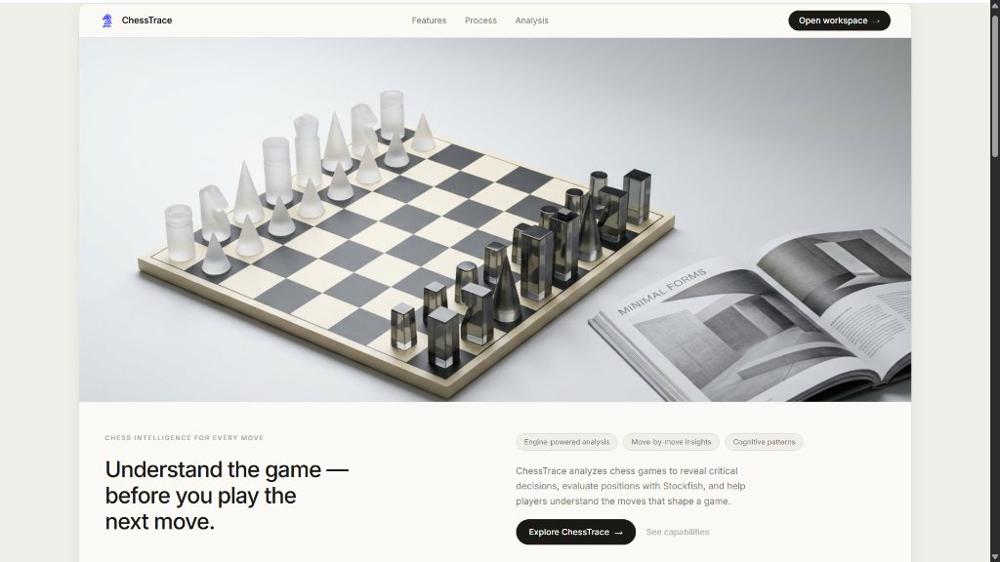
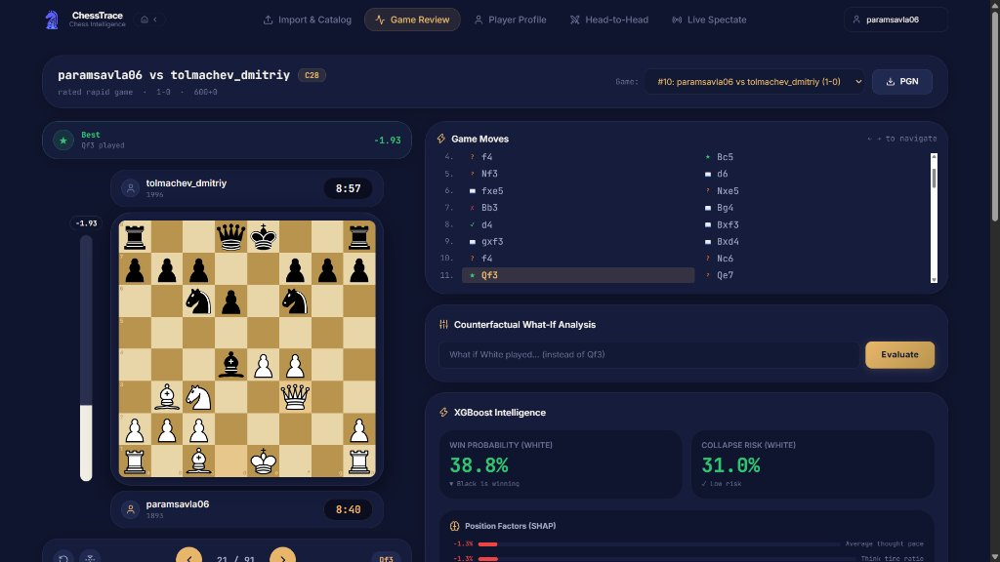
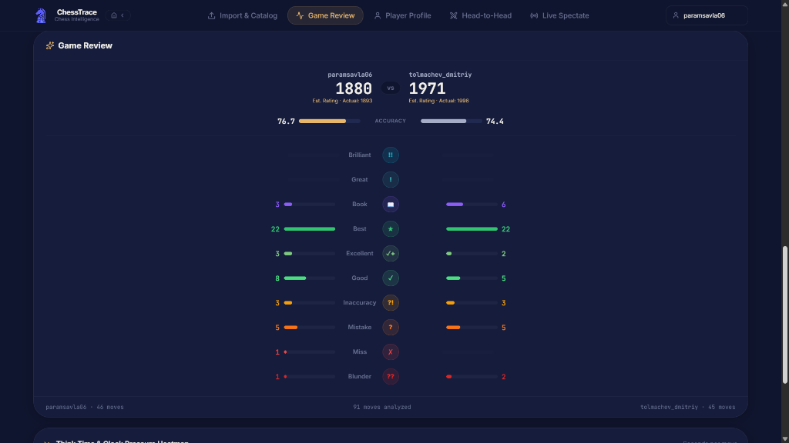

# ChessTrace

An open-source chess intelligence and cognitive analysis platform combining Stockfish engine evaluations with machine learning (XGBoost, SHAP explainability) to model human decision-making, time-pressure dynamics, and performance degradation.

[](https://chess-trace.vercel.app)
[](https://chesstrace.onrender.com/docs)
[](https://python.org)
[](https://react.dev)

---

## Overview

Traditional chess engines (such as Stockfish or Leela Chess Zero) evaluate positions assuming optimal play under unbounded computational limits. However, competitive human games are constrained by finite thinking time, cognitive fatigue, and psychological stress.

**ChessTrace** bridges this gap by combining traditional UCI engine analysis with trained gradient-boosted decision trees (XGBoost) and SHAP (SHapley Additive exPlanations). Beyond calculating best moves, ChessTrace models:

- **Time-Pressure Collapse Modeling**: Predicts the likelihood of game-altering blunders as clocks drop below critical thresholds (120s, 60s, 30s).
- **Explainable Positional Metrics**: Decomposes position evaluations into human-readable tactical and strategic factors via SHAP values.
- **Counterfactual What-If Exploration**: Evaluates alternative candidate moves against played moves to measure centipawn loss and win probability divergence.
- **Calibrated Rating Estimation**: Evaluates game accuracy to derive realistic performance ratings bounded within standard deviation brackets.
- **Real-Time Lichess Spectator Streaming**: Connects directly to ongoing games via Lichess's public NDJSON stream over WebSockets, performing per-move inference in sub-second latency.

---

## User Interface & Workspace

### 1. Architectural Landing Interface
Minimalist editorial interface presenting core analytical capabilities, opening repertoire health, and interactive board previews.



### 2. Move-by-Move Analysis Workspace
Interactive chessboard with Stockfish engine evaluations, live XGBoost win probability gauges, real-time collapse risk multipliers, SHAP factor attribution, and counterfactual What-If branch testing.



### 3. Performance Review & Calibrated Rating Estimation
Post-game review dashboard displaying move classification breakdowns (Brilliant, Great, Best, Excellent, Good, Inaccuracy, Mistake, Miss, Blunder), accuracy ratings, and calibrated performance estimation.



---

## System Architecture

```
┌────────────────────────────────────────────────────────────────────────┐
│                              DATA SOURCES                              │
│   • Lichess API (JSON/NDJSON live streams)                             │
│   • PGN Import (Preserves clock comments, FEN headers, ECO codes)      │
└──────────────────────────────────┬─────────────────────────────────────┘
                                   │
                                   ▼
┌────────────────────────────────────────────────────────────────────────┐
│                          INGESTION & PARSING                           │
│   • python-chess: Board validation, legal move trees, SAN parsing      │
│   • Move & Time Feature Extractor (40+ features per ply)               │
└──────────────────┬───────────────────────────────┬─────────────────────┘
                   │                               │
                   ▼                               ▼
┌──────────────────────────────────────┐  ┌──────────────────────────────┐
│        STOCKFISH UCI ENGINE          │  │       XGBOOST SUITE          │
│   • Principal variation (PV) search  │  │   • Win/Collapse Predictor   │
│   • Centipawn & mate depth analysis  │  │   • ELO-Bracket Models (7x)  │
│   • Positional heuristic fallback    │  │   • Style Archetype Cluster  │
└──────────────────┬───────────────────┘  └──────────────┬───────────────┘
                   │                                     │
                   └───────────────────┬─────────────────┘
                                       │
                                       ▼
┌────────────────────────────────────────────────────────────────────────┐
│                       SHAP EXPLAINABILITY ENGINE                       │
│   • TreeExplainer inference on gradient boosted feature vectors        │
│   • Generates plain-English narrative factor attribution per move      │
└──────────────────────────────────┬─────────────────────────────────────┘
                                   │
                                   ▼
┌────────────────────────────────────────────────────────────────────────┐
│                   FASTAPI ASYNC BACKEND (Uvicorn)                      │
│   • REST Endpoints: Game catalog, timeline, profiles, what-if branch   │
│   • WebSockets: Real-time live Lichess game streaming                  │
│   • Persistence: SQLAlchemy 2.0 ORM + PostgreSQL / SQLite              │
└──────────────────────────────────┬─────────────────────────────────────┘
                                   │
                                   ▼
┌────────────────────────────────────────────────────────────────────────┐
│                  REACT 19 + TYPESCRIPT FRONTEND                        │
│   • Interactive react-chessboard + chess.js engine integration         │
│   • Dynamic evaluation & collapse probability gauges                   │
│   • Recharts telemetry curves, move scrubber, board orientation flip   │
└────────────────────────────────────────────────────────────────────────┘
```

---

## Machine Learning & Statistical Pipeline

### 1. Win & Collapse Risk Predictor
The primary predictive model is an **XGBoost Regressor** trained on 512,000+ real move plies from rated human games in the Lichess Open Database.

#### Feature Matrix (40+ Variables):
- **Material Balance**: White material, Black material, pure piece count difference.
- **Mobility & Dynamics**: Legal move counts per side, piece activity indices.
- **Center Control**: Pawn and piece pressure exerted on $d4, e4, d5, e5$.
- **Pawn Structure**: Doubled pawns, isolated pawns, passed pawns, pawn chains.
- **King Safety**: Castling status, pawn shield integrity, open files near king.
- **Clock Telemetry**: Think time per move, absolute time remaining, time usage ratio relative to initial time control, running average think time.
- **Time Pressure Indices**: Categorical and continuous flags for $\le 120s$, $\le 60s$, and $\le 30s$ remaining.

### 2. SHAP Interpretability Engine
Raw model probabilities are paired with **SHAP TreeExplainer** values to isolate which specific factors contributed most to shifts in win or collapse probability:

$$\phi_i(x) = \sum_{S \subseteq F \setminus \{i\}} \frac{|S|!(|F| - |S| - 1)!}{|F|!} \left( f_x(S \cup \{i\}) - f_x(S) \right)$$

This translates numerical gradients into natural language feedback (e.g., *"White piece mobility (+17.2%) and center control (+8.5%) offset time pressure penalties (-4.1%)"*).

### 3. ELO-Stratified Human Move Simulation
A matrix of **7 separate XGBoost models** stratified across rating tiers:
- Under 1000
- 1000 – 1200
- 1200 – 1400
- 1400 – 1600
- 1600 – 1800
- 1800 – 2000
- 2000+

Each model predicts the candidate move probability distribution expected from human players at that specific rating level, allowing users to benchmark decisions against peer performance.

---

## Core Capabilities

### Move-by-Move Game Review
- Complete interactive move timeline with keyboard arrow navigation (`←`, `→`).
- Engine evaluation curve synced with move classifications (Brilliant, Great, Book, Best, Excellent, Good, Inaccuracy, Mistake, Miss, Blunder).
- Calibrated performance rating estimation bounded within realistic statistical brackets.
- Downloadable annotated PGN with embedded SHAP commentary.

### Counterfactual What-If Engine
- Allows input of any legal alternative move at any ply.
- Re-evaluates position with Stockfish and XGBoost.
- Calculates true centipawn delta ($\Delta \text{cp}$) from the active player's perspective.
- Classifies candidate moves as blunders, inaccuracies, or winning tactics even in lopsided endgames.

### Player Cognitive Profiling
- **Archetype Classification**: K-Means clustering assigning styles (Tactician, Positional Grinder, Time Pressure Collapser, Solid Classicalist).
- **Tilt Detection**: Quantifies acceleration/deceleration in think times immediately following material losses or mistakes.
- **Overthinking Coefficient**: Identifies excessive think time spent on forced or single-candidate moves.
- **Panic Reflex Counter**: Tracks sub-5-second moves played in high-complexity positions.

### Real-Time Live Spectating
- WebSocket connection to Lichess live games (`/api/v1/ws/live/{game_id}`).
- Works with any Lichess URL format (`https://lichess.org/game/{id}/black`, `https://lichess.org/{id}`, or raw 8-character ID).
- Auto-detects board orientation and live clocks.
- Automatic trailing move reconciliation upon game conclusion to ensure complete game history is delivered.
- One-click export from live stream directly into full Game Review.

---

## Technology Stack

| Domain | Technology | Details |
|---|---|---|
| **Backend Framework** | FastAPI (Python 3.10+) | Async endpoints, WebSocket support, automatic OpenAPI/Swagger docs |
| **Server** | Uvicorn / Gunicorn | High-concurrency ASGI web server |
| **Database & ORM** | PostgreSQL / SQLAlchemy 2.0 | Compatible with Neon serverless Postgres & local SQLite, Alembic migrations |
| **PostgreSQL Drivers** | `psycopg2-binary`, `psycopg 3` | Native support across Python 3.10–3.14 on Linux and Windows |
| **Chess Engine** | Stockfish 11 / 18 + python-chess | UCI protocol integration with heuristic positional fallback for constrained environments |
| **Machine Learning** | XGBoost, Scikit-learn, SHAP | 8 cached models, TreeExplainer, K-Means clustering, Isolation Forest |
| **Frontend Framework** | React 19, TypeScript, Vite | Fast build pipeline, component modularity, strict typing |
| **UI & Styling** | Tailwind CSS, Lucide React | Custom Geometria-inspired design tokens, accessible color hierarchy |
| **Chess Visualization** | `react-chessboard`, `chess.js` | Interactive piece manipulation, dynamic orientation flipping, move validation |
| **Deployment** | Render (Backend) + Vercel (Frontend) | Auto-deploy on `main` branch push |

---

## Repository Structure

```text
ChessTrace/
├── backend/
│   ├── app/
│   │   ├── api/
│   │   │   ├── v1/
│   │   │   │   ├── analysis.py       # Predict, What-If, ELO simulation endpoints
│   │   │   │   ├── games.py          # Game catalog, timeline, and review endpoints
│   │   │   │   ├── health.py         # Service health checks
│   │   │   │   ├── live_ws.py        # Real-time WebSocket live game streaming
│   │   │   │   └── upload.py         # PGN file ingestion & Lichess auto-import
│   │   │   └── router.py             # Top-level API router
│   │   ├── core/
│   │   │   ├── config.py             # Environment configuration & Stockfish resolver
│   │   │   └── logging.py            # Structured logging configuration
│   │   ├── database/
│   │   │   ├── connection.py         # SQLAlchemy engine with URL normalizer
│   │   │   ├── init_db.py            # Automatic schema creation on startup
│   │   │   └── session.py            # Database session factory
│   │   ├── engine/
│   │   │   ├── evaluator.py          # Stockfish analysis parser
│   │   │   └── stockfish.py          # UCI engine process management
│   │   ├── features/
│   │   │   ├── position_features.py  # 40+ topological board features
│   │   │   └── time_features.py      # Clock & think-time telemetry features
│   │   ├── ml/
│   │   │   ├── collapse_model.py     # Win & collapse XGBoost predictor
│   │   │   ├── elo_model.py          # Multi-bracket human move simulator
│   │   │   ├── explainer.py          # SHAP TreeExplainer integration
│   │   │   └── weights/              # Pretrained XGBoost model weights (JSON)
│   │   ├── models/                   # SQLAlchemy declarative ORM models
│   │   └── schemas/                  # Pydantic v2 validation models
│   ├── build.sh                      # Render build & optional Stockfish compilation
│   ├── Procfile                      # Uvicorn startup declaration
│   └── requirements.txt              # Pinned Python dependencies
├── docs/
│   └── assets/                       # UI screenshots and diagrams
├── frontend/
│   ├── src/
│   │   ├── api/                      # Axios client & typed API interfaces
│   │   ├── components/               # AppShell, Navbar, ErrorBoundary
│   │   ├── pages/
│   │   │   ├── CatalogPage.tsx       # Game list & PGN upload
│   │   │   ├── LandingPage.tsx       # Geometria editorial landing page
│   │   │   ├── LivePage.tsx          # Real-time live spectating workspace
│   │   │   ├── ProfilePage.tsx       # Player cognitive profile & archetypes
│   │   │   └── ReviewPage.tsx        # Move-by-move game review workspace
│   │   └── index.css                 # Design tokens, slider styles, typography
│   ├── index.html                    # SEO tags & web font imports
│   ├── package.json                  # Frontend dependencies & scripts
│   └── vite.config.ts                # Vite build configuration
└── README.md
```

---

## Getting Started Locally

### Prerequisites
- **Python**: 3.10, 3.11, or 3.12
- **Node.js**: 18.x or 20.x LTS
- **Stockfish**: (Optional) Download [Stockfish](https://stockfishchess.org/download/) and place the executable in system PATH or configure `STOCKFISH_PATH`. If omitted, ChessTrace runs with its high-performance ML positional evaluator.

### 1. Clone the Repository
```bash
git clone https://github.com/paramsavla06/ChessTrace.git
cd ChessTrace
```

### 2. Backend Setup
```bash
cd backend

# Create and activate virtual environment
python -m venv .venv
source .venv/bin/activate       # On Windows: .venv\Scripts\activate

# Install dependencies
pip install -r requirements.txt

# Configure environment variables
cp .env.example .env            # On Windows: copy .env.example .env
```

Start the FastAPI application:
```bash
uvicorn app.main:app --host 0.0.0.0 --port 8000 --reload
```
The API is now accessible at `http://localhost:8000`. Interactive documentation is available at `http://localhost:8000/docs`.

### 3. Frontend Setup
```bash
cd ../frontend

# Install dependencies
npm install

# Start development server
npm run dev
```
Open `http://localhost:5173` (or `http://localhost:3000`) in your browser.

---

## Environment Variables

| Variable | Scope | Description | Default |
|---|---|---|---|
| `DATABASE_URL` | Backend | PostgreSQL connection URL (e.g. Neon, Supabase) or SQLite | `sqlite:///./chesstrace.db` |
| `STOCKFISH_PATH` | Backend | Explicit path to Stockfish binary | Auto-detected from PATH / engine directory |
| `LICHESS_API_TOKEN` | Backend | Optional API token to bypass public Lichess rate limits | `""` |
| `CORS_ORIGINS` | Backend | Comma-separated list of allowed origins | `http://localhost:3000,http://localhost:5173` |
| `PORT` | Backend | Port bound by Uvicorn server | `8000` |
| `VITE_API_URL` | Frontend | Base HTTP URL for the backend API | `http://localhost:8000/api/v1` |

---

## API Reference Overview

Interactive Swagger documentation is auto-generated at `/docs`. Primary endpoints include:

| Method | Endpoint | Description |
|---|---|---|
| `POST` | `/api/v1/upload/pgn` | Parse and persist games from uploaded `.pgn` files |
| `POST` | `/api/v1/upload/lichess/{username}` | Auto-import the latest $N$ rated games for a Lichess user |
| `GET` | `/api/v1/games` | Query imported games with pagination and player filters |
| `GET` | `/api/v1/games/{id}/timeline` | Retrieve chronological move plies, FENs, and evaluations |
| `POST` | `/api/v1/analysis/predict` | Run XGBoost win/collapse prediction with SHAP factor breakdown |
| `POST` | `/api/v1/analysis/what-if` | Calculate counterfactual divergence between played and candidate moves |
| `POST` | `/api/v1/analysis/elo-sim` | Predict candidate human moves for a specific ELO bracket |
| `GET` | `/api/v1/analysis/profile/{username}` | Extract comprehensive cognitive profile and tilt metrics |
| `GET` | `/api/v1/analysis/openings/{username}` | Generate ECO opening health reports and win rates |
| `WS` | `/api/v1/ws/live/{game_id}` | Connect to live Lichess game stream for real-time spectating |

---

## Authors & Citation

**Param Savla**  
Electronics & Telecommunication Engineering, Sardar Patel Institute of Technology (SPIT), Mumbai  
[LinkedIn](https://linkedin.com/in/param-savla) · [GitHub](https://github.com/paramsavla06)

*Inspirations & Datasets:*
- Behavioral chess modeling inspired by Maia Chess ([McIlroy-Young et al., KDD 2020](https://maiachess.com)).
- Training game corpora sourced from the [Lichess Open Database](https://database.lichess.org).
- Engine analysis provided by the official open-source [Stockfish Chess](https://stockfishchess.org).

---

## License

This project is open-source and distributed under the [MIT License](LICENSE).


