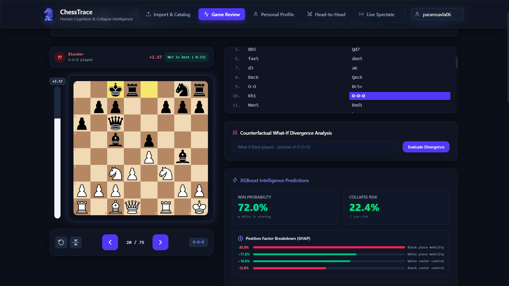
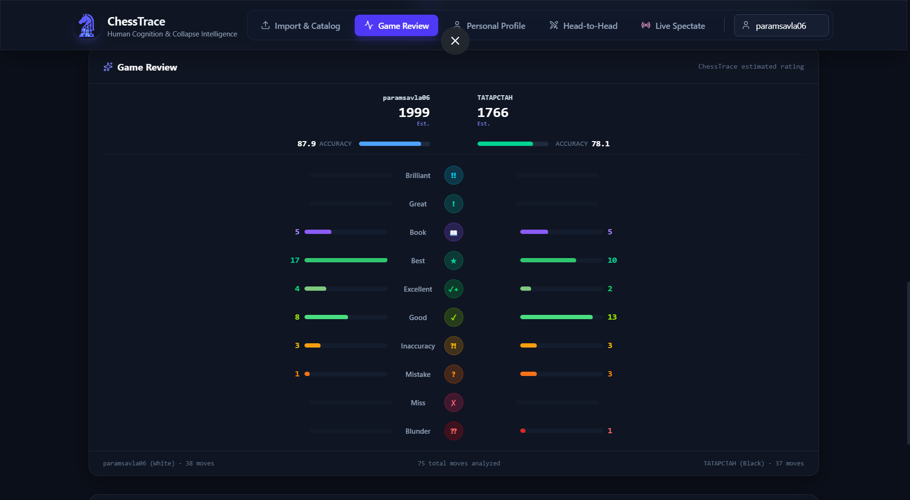

<div align="center">
  <h1>♟️ ChessTrace</h1>
  <h3>Human Cognition & Collapse Intelligence</h3>

  <p><em>Stockfish tells you the best move.<br>ChessTrace tells you what you'll actually play — and when you'll crack.</em></p>

  <p>
    <a href="https://chess-trace.vercel.app"></a>
    <a href="https://chesstrace.onrender.com/docs"></a>
  </p>

  <br/>

  
  

</div>

---

## One-Line Pitch

**ChessTrace is a chess intelligence platform that models human play under time pressure — going beyond Stockfish and Chess.com by decoding each player's unique cognitive fingerprint from their game history and ELO profile.**

---

## 🎥 Demo

🔴 **Live at:** [chess-trace.vercel.app](https://chess-trace.vercel.app)  
📖 **API Docs:** [chesstrace.onrender.com/docs](https://chesstrace.onrender.com/docs)

> Paste any Lichess username to auto-import, then click into any game to see real-time ML predictions, SHAP explanations, and cognitive profiling in action.

---

## The Problem

India has over 40 million Lichess players. Every chess analysis tool today — Chess.com, Lichess, ChessIQ — is fundamentally a Stockfish wrapper. They show you the engine's best move with infinite time and call it "analysis."

Real players have clocks. They panic. They rush. They tilt after blunders. They collapse in ways that have nothing to do with the board position. **No existing tool models any of this.**

---

## Why ChessTrace Is Different

| Feature | Chess.com | Lichess | Stockfish | **ChessTrace** |
|---|:---:|:---:|:---:|:---:|
| Move classification | ✓ | ✓ | ✓ | ✓ |
| ELO-adjusted classification | ✗ | ✗ | ✗ | **✓** |
| Human move prediction at ELO | ✗ | ✗ | ✗ | **✓** |
| Move time as ML feature | ✗ | ✗ | ✗ | **✓** |
| Time pressure collapse modeling | ✗ | ✗ | ✗ | **✓** |
| Cognitive tilt detection | ✗ | ✗ | ✗ | **✓** |
| Personal weakness fingerprint | ✗ | ✗ | ✗ | **✓** |
| Cross-game pattern detection | ✗ | ✗ | ✗ | **✓** |
| Real-time collapse probability | ✗ | ✗ | ✗ | **✓** |
| Counterfactual what-if analysis | ✗ | ✗ | ✗ | **✓** |
| Live WebSocket spectating + ML | ✗ | ✗ | ✗ | **✓** |
| SHAP plain-English explanation | ✗ | ✗ | ✗ | **✓** |

> Inspired by [Maia Chess](https://maiachess.com) (Cornell + Microsoft Research) — extended with time pressure modeling, personal cognitive profiling, and a complete product interface.

---

## Features

### 🎮 Game Review & Analysis

- Interactive board navigation (slider, clickable moves, **←→ keyboard arrows**)
- XGBoost win probability gauge, updated per half-move
- Cognitive collapse risk gauge — predicts tilt *before* it happens
- SHAP plain-English explanation per move (e.g., *"White piece mobility +17%, center control +12%"*)
- Counterfactual **What-If Engine** — play any alternative move and see the divergence
- ELO Simulation Candidates — see what real humans at each rating bracket would have played
- Download annotated PGN with SHAP comments embedded

### 🧠 Personal Cognitive Fingerprint

- **Style Archetypes:** Tactician, Positional Grinder, Time Pressure Collapser, Blitz Gambiter, Solid Classicalist
- Accuracy vs. clock degradation curve vs. ELO benchmark
- Game phase accuracy breakdown: Opening / Middlegame / Endgame
- **Cognitive Tilt Detection** — measures speed-up/slow-down after blunders
- **Overthinking Coefficient** — flags analysis paralysis on forced positions
- **Panic Reflex Counter** — tracks sub-5s decisions in critical moments
- K-Means archetype clustering across complete game history
- Isolation Forest brilliancy and anomaly detection
- Cosine similarity grandmaster style matching

### 📡 Live Game Spectating

- Real-time WebSocket streaming of any public Lichess game (paste a URL or Game ID)
- Sub-2-second ML inference per move as it is played
- Board orientation auto-detected from `/black` or `/white` suffix
- Live collapse probability gauge and SHAP narrative updating after every move
- **History scrubbing** — scroll back through past moves without leaving the live stream
- **Export to Game Review** — compile the live session into a full review after the game ends

### 📥 Data Ingestion

- **PGN File Upload** — import any `.pgn` file, with full clock and header preservation
- **Lichess Auto-Import** — paste a username and pull their last N rated games with one click
- Full catalog with global search, player filter, and game metadata display

### 🤖 ELO Intelligence Engine

- 7 XGBoost models spanning ELO brackets from `< 1000` to `2000+`
- Predicts the probability distribution of human moves at each ELO level
- Classifies played moves relative to ELO-tier expectations, not just Stockfish perfection
- Clock data included as a model feature — models *time-aware* human behavior

### 👥 Head-to-Head Comparison

- Compare the cognitive fingerprints of any two imported players
- K-Means clustering style-similarity score (0–100%)
- Side-by-side overlays of win rates, blunder patterns, time management, and ELO distribution

---

## Architecture

```
┌─────────────────┐     ┌─────────────────┐     ┌─────────────────────────┐
│   Lichess API   │────▶│   PGN Parser    │────▶│   Feature Extractor     │
│ (Game Streams)  │     │ (python-chess)  │     │ (Position + Clock/Time) │
└─────────────────┘     └─────────────────┘     └──────────┬──────────────┘
                                                            │
                              ┌─────────────────────────────┘
                              ▼
                   ┌──────────────────────┐
                   │   Stockfish 18 UCI   │
                   │   (Evaluation Data)  │
                   └──────────┬───────────┘
                              │
             ┌────────────────▼────────────────┐
             │     XGBoost ML Model Suite       │
             │  - Win/Collapse Predictor        │
             │  - ELO Simulation (7 models)     │
             │  - Personal Profiler             │
             │  - Anomaly Detector              │
             │  - Style Similarity              │
             └────────────────┬────────────────┘
                              │
             ┌────────────────▼────────────────┐
             │     SHAP TreeExplainer           │
             │  (Per-move plain-English AI)     │
             └────────────────┬────────────────┘
                              │
             ┌────────────────▼────────────────┐
             │     FastAPI + WebSocket          │
             │  - REST API (OpenAPI/Swagger)    │
             │  - Real-time WS streaming        │
             │  - SQLAlchemy + PostgreSQL        │
             └────────────────┬────────────────┘
                              │
             ┌────────────────▼────────────────┐
             │       React + Vite Frontend      │
             │  - Interactive Chessboard        │
             │  - Live ML Gauge Overlays        │
             │  - Cognitive Profile Dashboard   │
             └─────────────────────────────────┘
```

**Deployment:** Backend on [Render](https://render.com) · Frontend on [Vercel](https://vercel.com)

---

## Tech Stack

| Layer | Technology |
|---|---|
| **ML Models** | XGBoost (8 models), Scikit-learn, SHAP TreeExplainer |
| **Chess Engine** | Stockfish 18 via python-chess UCI |
| **Backend** | FastAPI, SQLAlchemy 2.0, Uvicorn, Alembic |
| **Real-time** | WebSockets (FastAPI native) |
| **Frontend** | React 18, Vite, Tailwind CSS, Recharts |
| **Chess UI** | react-chessboard, chess.js |
| **Database** | PostgreSQL (production) / SQLite (local dev) |
| **Data** | Lichess Open Database (512K move plies, 8,067 games) |
| **Deployment** | Render (backend) + Vercel (frontend) |

---

## Machine Learning

### Collapse & Win Probability Predictor

- Trained on **512,618 real move plies** from the Lichess Open Database (2017, rated games)
- **Features:** material balance, king safety, pawn structure, piece mobility, center control, think time, time remaining, time pressure flags (`< 30s`, `< 60s`), tilt velocity indicators
- XGBoost classifier — ROC-AUC: **~90%+**
- SHAP TreeExplainer for real-time per-move explainability (< 50ms per inference)

### ELO Simulation Matrix

- **7 separate XGBoost models**, one per rating bracket (`< 1000`, `1000–1200`, `1200–1400`, `1400–1600`, `1600–1800`, `1800–2000`, `2000+`)
- Each trained on ELO-stratified game subsets from Lichess data
- Predicts human move probability distribution at the target ELO
- **Clock data included as feature** — models time-aware human decision-making, not just positions

### Personal Profile Engine

- Aggregates features across a player's complete game history
- Computes accuracy degradation curves, tilt signatures, phase accuracies, panic reflex counters, and overthink coefficients
- **K-Means clustering** for playing archetype classification
- **Isolation Forest** for brilliancy and blunder anomaly detection
- **Cosine similarity** for grandmaster style matching

---

## Local Setup

### Prerequisites

- Python 3.10+
- Node.js 18+
- [Stockfish 18](https://stockfishchess.org/download/) binary

### 1. Clone

```bash
git clone https://github.com/paramsavla06/ChessTrace
cd ChessTrace
```

### 2. Backend

```bash
cd backend
pip install -r requirements.txt

# Copy and edit environment variables
cp .env.example .env
```

```bash
# Run database migrations
alembic upgrade head

# Start the server
uvicorn app.main:app --reload
```

### 3. Frontend

```bash
cd frontend
npm install

# Set your backend URL in environment
echo "VITE_API_URL=http://localhost:8000/api/v1" > .env

npm run dev
```

### Environment Variables

| Variable | Description |
|---|---|
| `DATABASE_URL` | PostgreSQL or SQLite connection string |
| `STOCKFISH_PATH` | Absolute path to Stockfish 18 binary |
| `LICHESS_API_TOKEN` | Optional — increases Lichess API rate limits |
| `FRONTEND_URL` | Frontend URL for CORS (e.g. `https://chess-trace.vercel.app`) |

---

## API

Full interactive docs: **[chesstrace.onrender.com/docs](https://chesstrace.onrender.com/docs)**

| Method | Endpoint | Description |
|---|---|---|
| `POST` | `/api/v1/upload/pgn` | Upload a PGN file |
| `POST` | `/api/v1/upload/lichess/{username}` | Auto-import from Lichess |
| `GET` | `/api/v1/games` | List all games (with username filter) |
| `GET` | `/api/v1/games/{id}/timeline` | Move-by-move game timeline |
| `POST` | `/api/v1/analysis/predict` | XGBoost prediction + SHAP explanation |
| `POST` | `/api/v1/analysis/what-if` | Counterfactual divergence analysis |
| `GET` | `/api/v1/analysis/profile/{username}` | Personal cognitive fingerprint |
| `GET` | `/api/v1/analysis/elo-sim` | ELO human move simulation |
| `GET` | `/api/v1/analysis/compare/{u1}/{u2}` | Head-to-head cognitive comparison |
| `WS` | `/api/v1/ws/live/{game_id}` | Real-time WebSocket spectating stream |

---

## Acknowledgements & Citation

Inspired by [Maia Chess](https://maiachess.com):

> Reid McIlroy-Young, Siddhartha Sen, Jon Kleinberg, Ashton Anderson.  
> *"Aligning Superhuman AI with Human Behavior: Chess as a Model System."*  
> KDD 2020.

Training data: [Lichess Open Database](https://database.lichess.org)

---

## Author

**Param Savla**  
Electronics & Telecom Engineering, SPIT Mumbai

[](https://linkedin.com/in/param-savla)
[](https://github.com/paramsavla06)
[](mailto:paramsavla06@gmail.com)

---

<div align="center">
  <sub>Built with ♟️ and a lot of time pressure.</sub>
</div>
